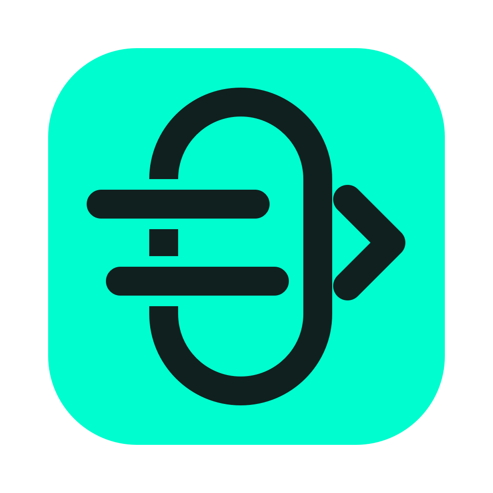
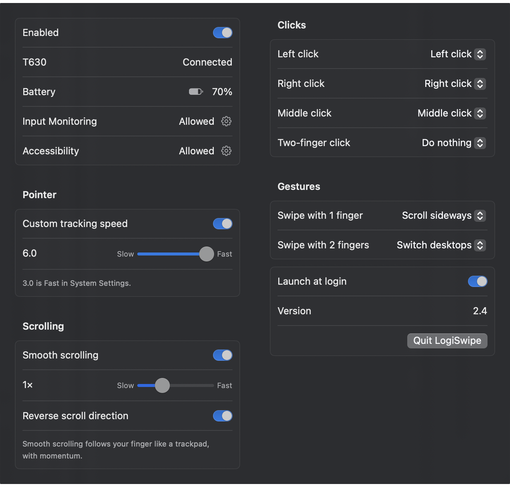

<p align="center">
  
</p>

# LogiSwipe for Logitech T630

Bring your **Logitech T630 Ultrathin Touch Mouse** back to life on modern macOS—without needing Logi Options.

**LogiSwipe** is a lightweight menu bar app that restores 2-finger desktop swipes and lets you customize clicks, gestures, scroll direction, and pointer speed specifically for your T630.

<a href="https://buymeacoffee.com/lordgift"></a>


Mouse specs: [Logitech Ultrathin Touch Mouse T630 Technical Specifications](https://support.logi.com/hc/th/articles/360023466613-Logitech-Ultrathin-Touch-Mouse-T630-Technical-Specifications)

## Why LogiSwipe?

Logitech discontinued **Logi Options**, and the newer **Logi Options+** does not support the T630. On macOS 27 and later, 2-finger swiping to switch desktops stopped working altogether.

LogiSwipe replaces Logi Options for the T630 in a tiny menu bar app—and only touches events from your T630, leaving your trackpad and other mice completely alone.

## Features

- **Trackpad-Style Scrolling**: Scroll with one finger, or with two fingers in any direction, with momentum.
- **1-, 2- & 3-Finger Swipes**: Switch between desktops (3 fingers by default), go Back / Forward in browsers, or scroll sideways.
- **Pinch to Zoom**: Pinch two fingers apart or together to zoom in or out.
- **3-Finger Swipes Up & Down**: Open Mission Control or show the current app's windows, like a Mac trackpad.
- **Double Tap**: Double-tap with 1 or 2 fingers to open Launchpad, capture the screen, show the current app's windows, or open Mission Control.
- **Custom Clicks**: Customize Left click, Right click, Middle click (pressing the upper center of the mouse), and Two-finger click. LogiSwipe decides which one from where your finger is, instead of the mouse's own guess.
- **Separate Scroll Direction**: Reverse scrolling just for the T630 without flipping your Mac's trackpad.
- **Custom Pointer Speed**: Set the T630's pointer speed independently—even faster than the maximum setting in macOS System Settings.
- **Battery Level**: See the T630's battery percentage in the menu, which macOS doesn't show.
- **Launch at Login**: Lives quietly in your menu bar and starts automatically when you log in.

## Installation

### Before you start
1. **Quit or uninstall Logi Options.**
2. Turn off **Logitech Options HID Driver Extension** in **System Settings → General → Login Items & Extensions → Driver Extensions**.
3. Make sure **Ctrl+←** and **Ctrl+→** are enabled in **System Settings → Keyboard → Keyboard Shortcuts → Mission Control** (used for switching desktops).

### Option A: Download from Releases (Recommended)
1. Download the latest `LogiSwipe-<version>.zip` from the **Releases** page and unzip it.
2. Move **LogiSwipe.app** to your `/Applications` folder.
3. If macOS says the app cannot be opened, run this once in Terminal:
   ```sh
   xattr -cr /Applications/LogiSwipe.app
   ```

### Option B: Build from Source
If you have Xcode or the Command Line Tools installed:
```sh
./build.sh
```
This builds and installs `/Applications/LogiSwipe.app`.

### Grant Permissions
1. Open **LogiSwipe**.
2. Allow both permissions in **System Settings → Privacy & Security** (you can click the gear icons inside LogiSwipe to jump right to them):
   - **Input Monitoring** (so LogiSwipe can detect your finger touches on the T630)
   - **Accessibility** (so LogiSwipe can perform custom clicks, scrolls, and shortcuts)
3. **Quit and reopen LogiSwipe** from the menu bar icon. Both permissions should now say **Allowed**.

## Settings

Click the mouse icon in the menu bar. Settings only apply to the T630. Other mice and the trackpad are left alone.



| Setting | Options | Default |
|---|---|---|
| **Custom tracking speed** | `0.0` – `6.0`, marked at macOS's fastest, "Fast" (`3.0`) | Off (uses system speed) |
| **Reverse scroll direction** | Flips Natural scrolling for the T630 only | Off |
| **Left click** | Left click, Right click, Middle click, Back, Forward, Launchpad, Capture screen, App windows, Mission Control, Edit → Cut / Copy / Paste, Open app…, Do nothing | Left click |
| **Right click** | *(same as above)* | Right click |
| **Middle click** (press the upper center) | *(same as above)* | Middle click |
| **Hold middle click** (½ s) | Launchpad, Capture screen, App windows, Mission Control, Edit → Cut / Copy / Paste, Open app…, Do nothing | Capture screen |
| **Two-finger click** | Middle click, Launchpad, Capture screen, App windows, Mission Control, Edit → Cut / Copy / Paste, Open app…, Do nothing | Copy |
| **Swipe with 1 finger** | Scroll sideways, Switch desktops, Back / Forward, Do nothing | Back / Forward |
| **Swipe with 2 fingers** | Scroll freely (any direction), Switch desktops, Back / Forward, Do nothing | Scroll freely |
| **Swipe with 3 fingers** (left / right) | Switch desktops, Back / Forward, Do nothing | Switch desktops |
| **Double-tap with 1 finger** | Launchpad, Capture screen (like ⌘⇧4), App windows (like ⌃↓), Mission Control, Edit → Cut / Copy / Paste, Open app… (pick any app), Do nothing | App windows |
| **Double-tap with 2 fingers** | *(same as above)* | Paste |
| **Swipe up with 3 fingers** | *(same as above)* | Mission Control |
| **Swipe down with 3 fingers** | *(same as above)* | Do nothing |
| **Pinch to zoom** | Pinch 2 fingers to zoom in and out smoothly, like a trackpad | On |
| **Launch at login** | On / Off | Off |

## Tips & Troubleshooting

- **How swipes feel**: Swiping left moves to the desktop on the right (just like a MacBook trackpad). Once your fingers slide about a fifth of the way across the surface, the desktop switches immediately—you don't need to lift your fingers first.
- **T630 shows "Not connected"**: Move or click the mouse to wake it up, and check that it is connected in Bluetooth settings.
- **Nothing works after rebuilding from source**: Without the maintainer's signing identity, local builds are signed ad hoc, so macOS treats each build as a new app. Open **Input Monitoring** and **Accessibility** in System Settings, remove (`−`) LogiSwipe, add (`+`) it again, then quit and reopen LogiSwipe.
